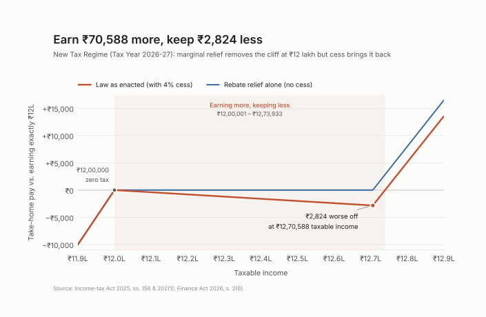

# Dhaal

Dhaal checks Indian income tax rules using **Lean 4** (a computer program that checks mathematical and logical proofs step by step).
It models the new tax regime under the Income Tax Act, 2025, for Tax Year 2026-27.

## Need

Suppose you earn ₹12,00,000 a year.  Under Section 156 of the Income Tax Act, 2025, you pay ₹0 in tax.
Now suppose you get a ₹70,000 raise, bringing your income to ₹12,70,000. Your tax jumps from ₹0 to ₹72,800. You earned ₹70,000 more, yet your take-home pay fell by ₹2,800.

This problem is called a **tax cliff** (a sudden jump where earning more money leaves you with less after tax).

Dhaal proves three facts about how these rules interact:

1. **Marginal relief prevents a cliff on its own.** Under Section 156, **marginal relief** (a rule that caps your extra tax so it never exceeds the extra income you earned above the tax-free limit) keeps the tax system **cliff-free** (earning more never lowers your take-home pay).
2. **The 4% cess brings the cliff back.** Under Section 2(6) of the Finance Act, 2026, the Health and Education Cess is added *after* the rebate and marginal relief are calculated. Because the cess is applied on top, any income between ₹12,00,001 and ₹12,73,933 leaves you with less take-home pay than earning ₹12,00,000. Between ₹12,00,000 and ₹12,70,000, the effective tax rate on that extra ₹70,000 is 104%.
3. **This is a general structural rule.** Any rebate with marginal relief is cliff-free as long as the base tax never drops and never grows faster than income. However, charging any positive surcharge or cess on top of a capped tax always creates a cliff.

## Visual Overview



* **Blue line (tax after rebate and marginal relief):** Stays flat enough that take-home pay never drops as income rises.
* **Red line (total tax with 4% cess):** Dips into a cliff between ₹12,00,001 and ₹12,73,933, where earning more leaves you with less.

## Statutory Sources

* **Tax slabs:** [Income Tax Act, 2025](https://www.incometaxindia.gov.in/documents/d/guest/income_tax_act_2025_as_amended_by_fa_act_2026-pdf), Section 202(1)
* **Rebate and marginal relief:** Income Tax Act, 2025 (No. 30 of 2025), Section 156(2)
* **Health and Education Cess (4%):** [Finance Act, 2026](https://egazette.gov.in/WriteReadData/2026/271439.pdf), Section 2(6)

## What Is Proved

In Lean 4, a **theorem** is a rule backed by a step-by-step logical proof that the computer has verified as 100% error-free.

Dhaal splits its proofs into two files: general rules that apply to any tax system, and specific rules for India.

### General Rules (`Dhaal/General.lean`)

* **`baseTax_lipschitz`:** A progressive **tax slab** (income brackets taxed at increasing rates) never increases tax faster than the highest bracket rate. For example, if the top tax rate is 30%, a ₹100 raise adds at most ₹30 in base tax.
* **`taxAfterRebate_lipschitz`:** A rebate with marginal relief is guaranteed to be cliff-free for *every* possible income, provided the maximum rebate covers the tax owed at the threshold.
* **`withCess_cliff`:** Adding any positive cess on top of a tax with marginal relief always creates a cliff. The proof demonstrates this by providing a **witness** (a concrete pair of income numbers where the rule fails): an income right at the threshold and an income slightly above it.

### Indian Tax Rules (`Dhaal/India.lean`)

* **`taxBeforeRebate_lipschitz`:** Under the 2026-27 slabs, base tax never rises by more than 30% of any income increase.
* **`taxAfterRebate_lipschitz`:** Before cess is added, Section 156 marginal relief guarantees that no taxpayer faces a cliff at any income level.
* **`taxWithCess_cliff`:** With the 4% cess included, a cliff exists. The proof uses a specific example: moving from ₹12,00,000 to ₹12,70,000 increases income by ₹70,000, while total tax increases by ₹72,800.

*(NB: The proof that take-home pay never falls before cess—named `incomeIn_lipschitz`—is written twice in the code using two different proof styles to serve as a reference for Lean learners.)*

## Checking Against Official Figures

Every number in the table below matches the [official tax calculator](https://www.incometax.gov.in) on the Income Tax e-filing portal.
These exact cases are also built into `Dhaal/India.lean` so the computer re-checks them every time the project builds.
The file `validation.py` checks over 40 income points using the same formulas.

| Income (₹) | Base Tax (₹) | Rebate (₹) | Tax After Rebate (₹) | Total Tax with 4% Cess (₹) | Take-Home Pay (₹) |
|---:|---:|---:|---:|---:|---:|
| 10,00,000 | 40,000 | 40,000 | 0 | 0 | 10,00,000 |
| 12,00,000 | 60,000 | 60,000 | 0 | 0 | 12,00,000 |
| 12,10,000 | 61,500 | 51,500 | 10,000 | 10,400 | 11,99,600 |
| 12,70,000 | 70,500 | 500 | 70,000 | 72,800 | 11,97,200 |
| 13,00,000 | 75,000 | 0 | 75,000 | 78,000 | 12,22,000 |
| 25,00,000 | 3,30,000 | 0 | 3,30,000 | 3,43,200 | 21,56,800 |

## How to Run the Project

1. **Install and verify the Lean 4 proofs:**
   ```bash
   git clone [https://github.com/sayyadirfanali/dhaal](https://github.com/sayyadirfanali/dhaal) && cd dhaal
   lake exe cache get   # Downloads prebuilt math libraries to save time
   lake build           # Checks all legal and mathematical proofs
   ```

2. **Regenerate the validation table and chart (optional):**
   ```bash
   pip install -r requirements.txt
   python3 validation.py
   python3 chart.py
   ```

## Authorship

I read the statutes, made the modelling decisions, and wrote most of the Lean proofs.

Claude helped with **Mathlib** lemmas, Lean proof steps, some general proofs, and drafted the Python scripts and the README.

Gemini helped with the README editing.

I have reviewed all definitions, proofs, and scripts and verified that they match the claims stated here.

## Contact

Irfan Ali | [irfanali.org](https://irfanali.org)

Corrections are welcome, especially regarding my reading of the statutes.

Please open an issue on GitHub or email me.

## License

[MIT](LICENSE)
