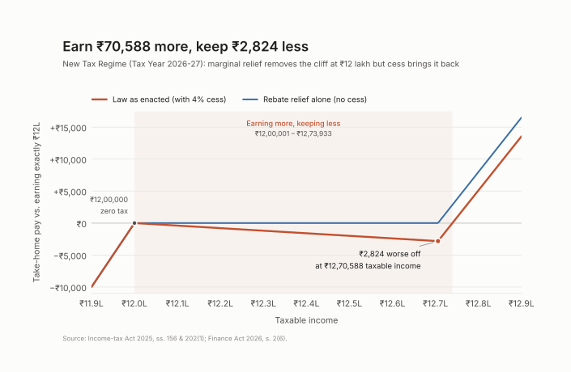

# Dhaal

Dhaal is a Lean 4 model of the new tax regime under the Income-tax Act, 2025, for Tax Year 2026-27. It proves that the rebate's marginal relief removes the **tax cliff** at ₹12 lakh, and that the 4% cess brings it back.

## Findings

> The rebate with marginal relief (Income-tax Act, 2025, s.156) is **cliff-free**: for any incomes x ≤ y, the increase in tax is at most the increase in income.

> The Health and Education Cess (Finance Act, 2026, s.2(6)) **reintroduces a cliff** just above ₹12L, with a marginal tax rate of 104%. At worst, a taxpayer earning ₹12,70,588 takes home ₹2,824 less than one earning ₹12,00,000.

The first result is proved in Lean for every income. The second is a concrete counterexample, also checked by Lean.

## Chart



The blue line is the rebate with marginal relief alone. It stays flat at zero, so there is no cliff.

The red line adds the 4% cess. Between ₹12,00,001 and ₹12,73,933, take-home pay is lower than at ₹12,00,000: earning more leaves you with less.

## Sources

- **Slab rates:** Income-tax Act, 2025 (No. 30 of 2025), s.202(1)
- **Rebate and marginal relief:** Income-tax Act, 2025 (No. 30 of 2025), s.156(2)
- **Cess:** Finance Act, 2026 (No. 4 of 2026), s.2(6)

Texts used:

- [Income-tax Act, 2025, as amended by the Finance Act, 2026](https://www.incometaxindia.gov.in/documents/d/guest/income_tax_act_2025_as_amended_by_fa_act_2026-pdf) (Income Tax Department)
- [Finance Act, 2026](https://egazette.gov.in/WriteReadData/2026/271439.pdf) (Gazette of India)

## Scope

- **Input:** taxable income, after the standard deduction.
- **In scope:** new regime, individual taxpayer, slab rates, rebate with marginal relief, 4% cess.
- **Out of scope:** surcharge, rounding of tax to the nearest ₹10, the old regime, special-rate income such as capital gains.
- **Numbers:** exact rationals (ℚ), so every value can be computed and checked.

## Theorems

```lean
theorem taxBeforeRebate_lipschitz {x y : ℚ} (h : x ≤ y) :
    taxBeforeRebate y - taxBeforeRebate x ≤ 3 / 10 * (y - x)
```

*For any incomes x ≤ y, slab tax rises by at most 30% of the rise in income.*

```lean
theorem taxAfterRebate_lipschitz {x y : ℚ} (h : x ≤ y) :
    taxAfterRebate y - taxAfterRebate x ≤ y - x
```

*After the rebate, tax rises by at most the rise in income: marginal relief prevents a cliff.*

```lean
theorem taxWithCess_cliff :
    ∃ x y : ℚ, x ≤ y ∧ y - x < taxWithCess y - taxWithCess x
```

*With cess, there are incomes where tax rises by more than income. From ₹12,00,000 to ₹12,70,000, income rises ₹70,000 and tax rises ₹72,800.*

The supporting lemmas are in [`Dhaal/IncomeTax.lean`](Dhaal/IncomeTax.lean). `incomeIn_lipschitz` is proved twice, once by case analysis and once as a `calc` chain, to show both styles.

## Validation

Every figure below matches the [official tax calculator](https://www.incometax.gov.in) on the Income Tax e-filing portal. The same figures are Lean `example`s at the end of `Dhaal/IncomeTax.lean`, checked on every build. `validation.py` computes the full table of 40+ incomes with the same formulas.

| Income | Base tax | Rebate | After rebate | Total tax (with cess) | Take-home |
|---:|---:|---:|---:|---:|---:|
| 10,00,000 | 40,000 | 40,000 | 0 | 0 | 10,00,000 |
| 12,00,000 | 60,000 | 60,000 | 0 | 0 | 12,00,000 |
| 12,10,000 | 61,500 | 51,500 | 10,000 | 10,400 | 11,99,600 |
| 12,70,000 | 70,500 | 500 | 70,000 | 72,800 | 11,97,200 |
| 13,00,000 | 75,000 | 0 | 75,000 | 78,000 | 12,22,000 |
| 25,00,000 | 3,30,000 | 0 | 3,30,000 | 3,43,200 | 21,56,800 |

At ₹12,10,000, take-home (₹11,99,600) is less than at ₹12,00,000 (₹12,00,000). That is the cliff.

## Build

```bash
git clone https://github.com/sayyadirfanali/dhaal && cd dhaal
lake exe cache get   # downloads prebuilt Mathlib
lake build
```

To regenerate the table and the chart:

```bash
pip install -r requirements.txt
python3 validation.py
python3 chart.py
```

## Next Steps
- Surcharge and its marginal relief, at the surcharge thresholds (₹50L, ₹1Cr, …)
- Rounding of tax to the nearest ₹10, which may create small cliffs of its own
- A general theorem: any bracket schedule with rates in [0, 1] is cliff-free, and the exact condition under which a rebate plus cess stays cliff-free
- Re-checking past budgets with the general theorem

## Authorship

I read the statutes, made the modelling decisions and wrote the Lean proofs. I used Claude as a tutor for Lean tactics and Mathlib lemmas, and to draft the Python scripts and parts of this README.

## Contact

Sayyad Irfan Ali · irfan@irfanali.org · [irfanali.org](https://irfanali.org)

Corrections are welcome, especially on how I've read the statute. Open an issue or email me.

## License

[MIT](LICENSE)
